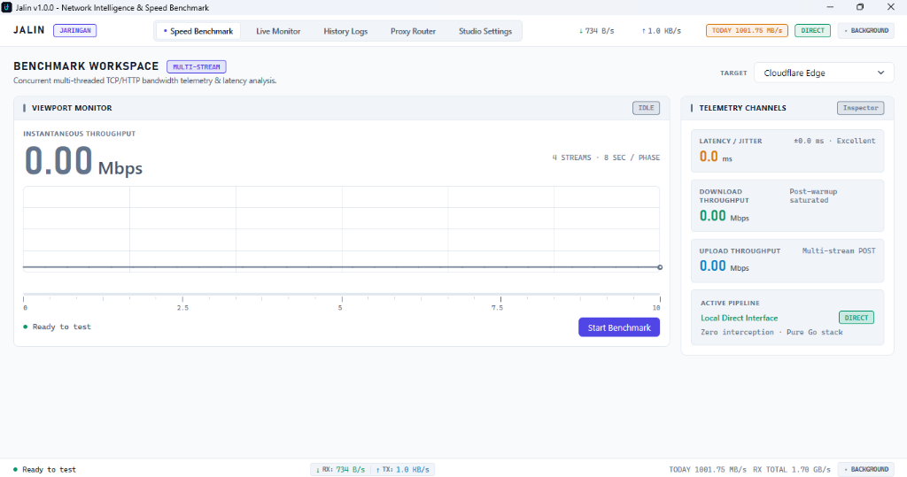
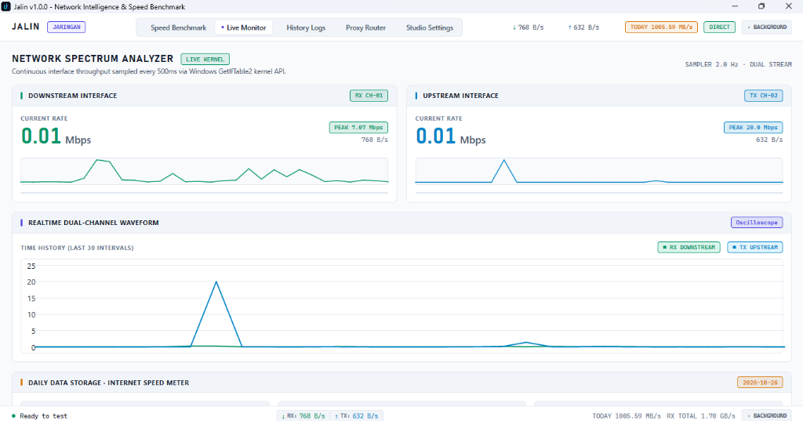
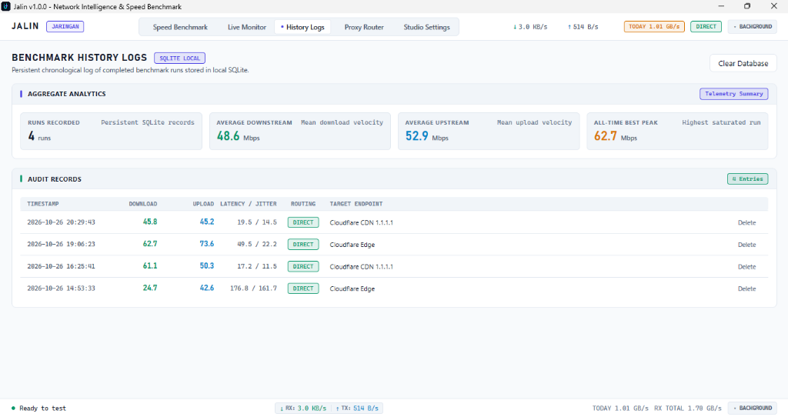
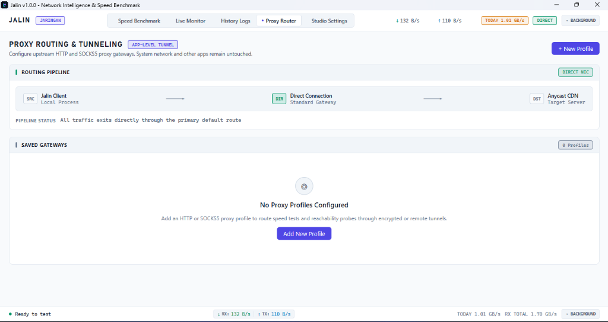
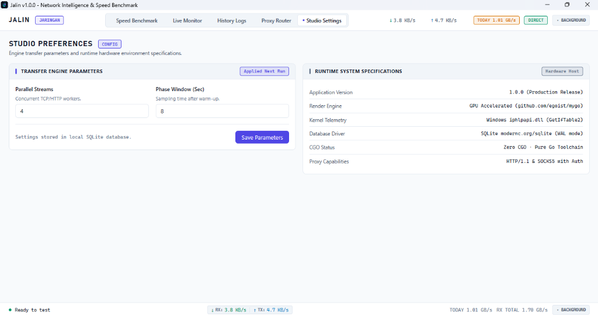

<p align="center">
  
</p>

<p align="center">
  <strong>Native Network Intelligence, Multi-Stream Benchmark & Floating Speed Meter for Windows</strong>
</p>

<p align="center">
  <a href="#features"></a>
  <a href="#tech-stack"></a>
  <a href="#installation"></a>
  <a href="#tech-stack"></a>
  <a href="#license"></a>
</p>

---

## Overview

**Jalin** is a high-performance desktop network utility and bandwidth intelligence workstation built entirely in **pure Go** with zero CGO dependencies. 

Powered by native GPU-accelerated rendering via `github.com/egoist/mygo`, Jalin brings studio-grade network telemetry, concurrent multi-stream speed benchmarking, daily internet data metering, app-level proxy routing, and an interactive draggable floating speed meter to the Windows desktop.

<p align="center">
  
</p>

---

## Visual Showcase

| View | Screenshot |
|---|---|
| **Speed Benchmark Workspace** |  |
| **Live Network Spectrum Analyzer** |  |
| **Benchmark History Logs** |  |
| **Proxy Routing & Tunneling** |  |
| **Studio Preferences & System Specs** |  |

---

## Key Features

### 1. Multi-Stream Speed Benchmark Engine
- **Concurrent TCP/HTTP Workers**: Parallel multi-threaded download and upload benchmarking with minimal warm-up jitter.
- **Real-Time Oscilloscope Waveform**: Canvas streaming live throughput fluctuations during test phases.
- **Precision Metrics**: Measures download Mbps, upload Mbps, round-trip latency (ping), and jitter.
- **Configurable Profiles**: Customize worker stream counts and phase duration with server endpoint selectors (e.g. Cloudflare Edge, Fast, Custom).

<p align="center">
  
</p>

### 2. Live Kernel Network Spectrum Analyzer
- **Direct Kernel Telemetry**: Samples interface traffic directly from the Windows kernel stack (`iphlpapi.dll` - `GetIfTable2`) every 500ms with zero packet-sniffing overhead.
- **Dual-Channel Monitor**: Independent live throughput tracking for downstream RX and upstream TX.
- **Filter Driver Suppression**: Automatically suppresses virtual filter shims (WFP, Npcap, VPN virtual adapters) to prevent double accounting.

<p align="center">
  
</p>

### 3. Draggable Floating Taskbar Speed Meter
- **Docked Taskbar Widget**: A sleek, minimal status bar displaying live `↓ RX` and `↑ TX` speeds.
- **Freely Draggable**: Easily click and drag anywhere on the grip handle `⠿` or throughput indicators to position the widget anywhere on your screen.
- **Persistent Coordinates**: Window coordinates are remembered and automatically restored across reboots and minimize actions.
- **Permanent TopMost Lock**: Utilizes Windows native `WS_EX_TOOLWINDOW | WS_EX_TOPMOST` attributes to stay above all active windows without losing z-order during focus changes.
- **One-Click Controls**: Instant window expand/restore button (`⤢`) and complete application exit button (`✕`).

### 4. Internet Speed Meter & Daily Data Tracking
- **Adapter-Level Categorization**: Distinguishes wireless IEEE 802.11 Wi-Fi traffic from physical Ethernet/LAN and virtual adapters.
- **Local SQLite Persistence**: Historical cumulative data usage is safely stored in an embedded SQLite database (`modernc.org/sqlite`) in WAL mode.
- **Daily Analytics**: Track daily, monthly, and aggregate download/upload consumption logs.

<p align="center">
  
</p>

### 5. Proxy Routing & Tunnel Pipeline
- **Application-Level Gateway**: Route speed tests and connectivity audits through configured HTTP or SOCKS5 proxies without altering OS-wide network configurations.
- **Visual Node Pipeline**: Live inspection of local client (`SRC`), routing node (`DIR` or `TUN`), and remote target (`DST`).
- **Reachability Latency Probing**: Built-in latency testing for configured proxy servers.

<p align="center">
  
</p>

### 6. Modern Studio Ergonomics & Clean White Aesthetic
- **Anti-Glare Palette**: Soft off-white canvas (`#F8FAFC`) with crisp pure-white panels (`#FFFFFF`) and slate typography (`#0F172A`).
- **No-Emoji Standard**: Strict vector geometry, clean icons, and technical monospace badges.
- **Clean Exit Behavior**: Clicking `[X]` cleanly exits the application; use the `BACKGROUND` button to minimize to the taskbar meter.

<p align="center">
  
</p>

---

## Tech Stack

| Layer | Technology | Details |
|---|---|---|
| **Language & Runtime** | Go 1.22+ | Pure Go, zero CGO, compiled directly to lightweight native binary |
| **Windowing & UI Toolkit** | `github.com/egoist/mygo` | GPU-accelerated Direct2D / DirectX native vector graphics |
| **Network Interface Telemetry** | Windows `iphlpapi.dll` | Pure Go kernel syscalls (`GetIfTable2`, `FreeMibTable`) |
| **Embedded Storage** | `modernc.org/sqlite` | Zero-CGO SQLite engine with WAL mode and parameterized queries |
| **Proxy Transport** | `net/http` + `golang.org/x/net/proxy` | Standard library HTTP + SOCKS5 client dialers |

---

## Project Structure

```
.
├── main.go                     # Bootstrap, multi-window coordinator, system tray, DWM
├── install.bat                 # One-click Windows installer launcher
├── installer.ps1               # Automated installation, desktop shortcuts, registry setup
├── uninstall.bat               # Clean uninstallation launcher
├── assets/                     # Application icons and branding vectors
│   ├── icon.png                # High-res application icon
│   ├── logo.svg                # Master vector brand mark
│   ├── logo.ico                # Multi-resolution Windows executable icon
│   └── screenshots/            # Showcase previews and screenshots
│       ├── 01-speed-benchmark.png
│       ├── 02-live-monitor.png
│       ├── 03-history-logs.png
│       ├── 04-proxy-router.png
│       └── 05-studio-settings.png
├── internal/
│   ├── netstat/                # Real-time network interface monitor (GetIfTable2)
│   │   ├── netstat.go          # Monitor coordinator, delta calculation, telemetry
│   │   ├── netstat_windows.go  # Windows kernel MIB_IF_ROW2 octet readers
│   │   └── netstat_other.go    # Cross-platform non-Windows fallback
│   ├── speedtest/              # Benchmark engine (download, upload, latency, jitter)
│   │   ├── engine.go           # Multi-threaded HTTP worker coordinator
│   │   ├── servers.go          # Endpoint registry (Cloudflare Global, etc.)
│   │   └── util.go             # Metric formatters and numerical helpers
│   ├── store/                  # SQLite storage layer (modernc.org/sqlite)
│   │   ├── db.go               # Connection pooling, migrations, queries
│   │   └── models.go           # Data models (SpeedResult, DailyUsage, ProxyProfile)
│   ├── proxy/                  # HTTP & SOCKS5 proxy dialer and reachability tester
│   └── ui/                     # Native GPU UI views and workstation components
│       ├── design.go           # Theme tokens, fonts, responsive breakpoints
│       ├── state.go            # Reactive UI state coordinator and event bus
│       ├── view_main.go        # Faceplate navigation ribbon, tab router, status console
│       ├── view_mini.go        # Draggable floating taskbar speed meter view
│       ├── view_speedtest.go   # Speed benchmark dock and oscilloscope viewport
│       ├── view_monitor.go     # Live network analyzer and daily usage meter
│       ├── view_history.go     # Historical benchmark audit log table
│       ├── view_proxy.go       # Proxy configuration modal and routing pipeline
│       └── view_settings.go    # Workstation preferences and hardware telemetry
├── AGENTS.md                   # Architecture standards and development guidelines
├── README.md                   # Comprehensive documentation
└── go.mod                      # Go module definitions
```

---

## Installation & Setup

### Option 1: Automated One-Click Installer (Recommended)

1. Double-click **`install.bat`** (or run `powershell -ExecutionPolicy Bypass -File .\installer.ps1 -Install`).
2. Jalin will be automatically built and installed into:
   ```
   %LocalAppData%\Programs\Jalin\
   ```
3. Shortcuts will be placed on your **Desktop** and **Start Menu**.
4. Jalin is officially registered in **Windows Settings > Installed Apps** for convenient uninstallation.

To remove Jalin cleanly, double-click **`uninstall.bat`** or uninstall it from Windows Settings.

---

### Option 2: Build from Source

#### Prerequisites
- Go 1.22 or newer installed.
- Windows 10 / 11 (64-bit).

#### Run Locally
```bash
go run .
```

#### Build Release Binary (~16MB, No Console Window)
```bash
go build -trimpath -ldflags="-s -w -H=windowsgui" -o jalin.exe .
```

---

## Development & Verification

Run tests and linters:

```bash
# Run all unit tests
go test ./...

# Run Go vet linter
go vet ./...

# Verify code formatting (must produce no output)
gofmt -l .
```

---

## License

Distributed under the **MIT License**. See `LICENSE` for more information.
